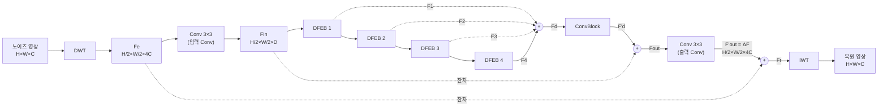
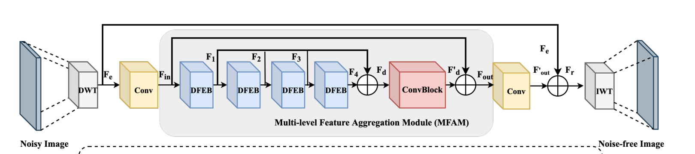
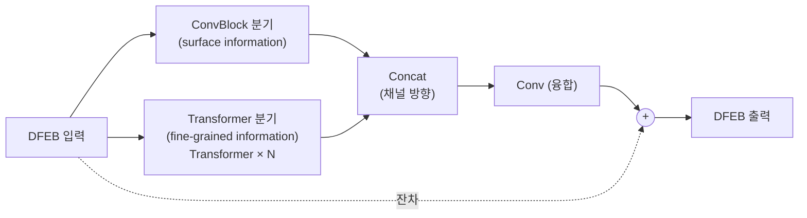
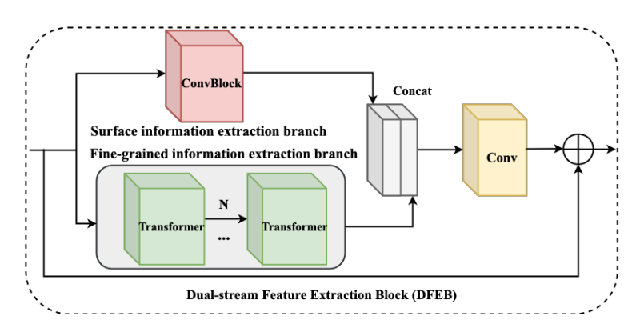
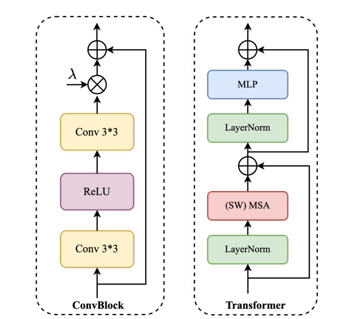

# EWT: Efficient Wavelet-Transformer for Single Image Denoising

## 논문 정보

- **저자:** Juncheng Li, Bodong Cheng, Ying Chen, Guangwei Gao, Tieyong Zeng
- **발표 연도 / 학회:** 2023년 4월 arXiv v1. 서지 검색에서 *Neural Networks* 177권(2024), 논문 번호 106378의 저널판이 확인되나, 저널판 본문은 검토하지 않았다(저자 구성 등 차이 미확인).
- **논문:** [arXiv:2304.06274](https://arxiv.org/abs/2304.06274)
- **공식 코드:** 논문(arXiv v1)에는 링크가 없고 "All code will be public"이라고만 적었다. 공식 구현이라고 스스로 밝힌 저장소 [MIVRC/EWT-PyTorch](https://github.com/MIVRC/EWT-PyTorch)를 확인했고(2026-11-16) 4절 구조 설명의 대조에만 사용했다. 저자 소유 여부와 arXiv v1과의 버전 일치는 미확인이다.
- **키워드:** Image Denoising, DWT, Wavelet, Transformer, CNN, Efficiency
- **리뷰 작성일:** 2026-11-03 (2026-11-16 보완, 4절 모델 구조 설명 보강)
- **검토한 논문 버전:** arXiv v1 (2023-04-13, 12쪽)

## 1. 한 줄 요약

DWT로 입력을 네 주파수 대역으로 분해해 해상도를 절반으로 줄이고, CNN과 윈도우 기반 Transformer를 병렬로 결합해 복원 성능과 연산 효율(시간·GPU 메모리)의 균형을 추구한 denoising 모델이다.

## 2. 연구 배경과 문제 정의

고해상도 영상에 Transformer를 적용하면 실행 시간과 GPU 메모리 부담이 크다. 저자들은 SwinIR처럼 Transformer 블록을 많이 쌓은 모델이 성능은 좋지만 자원 소모가 커서, 성능 향상과 자원 소비 사이의 균형을 이루지 못한다고 본다.

해상도를 줄이는 기존 방법(pooling, stride convolution, 크롭)은 정보 손실이나 전역 정보 손실을 일으킨다. 저자들은 가역적인 DWT를 다운샘플링으로, IWT를 업샘플링으로 사용해 이 문제를 피하려 한다. 또한 Transformer 비중이 너무 높으면 자원 대비 성능이 나빠진다고 보고, CNN 분기를 함께 쓰는 구조를 설계했다.

## 3. 핵심 아이디어 및 기여

논문이 주장하는 기여는 다음과 같다.

1. **DWT/IWT 샘플링:** 입력에 DWT를 적용하고 출력에서 IWT로 원래 해상도를 복원한다. 저자들은 이것을 "웨이블릿 영역에서 Transformer를 사용한 첫 시도"라고 주장한다(리뷰어가 검증하지 않은 주장).
2. **DFEB (Dual-stream Feature Extraction Block):** CNN 분기와 Transformer 분기를 병렬로 사용하고 출력을 결합해 특징을 융합한다.
3. **MFAM (Multi-level Feature Aggregation Module):** 여러 DFEB의 출력을 모두 더해 집계하고, 지역·전역 잔차 연결을 사용한다.
4. **효율:** 원래 Transformer 대비 속도 80% 이상 향상, GPU 메모리 60% 이상 절감을 주장한다(근거는 Table V).

## 4. 모델 구조와 동작 과정

이 절은 전체 구조와 텐서 흐름을 먼저 보고, 모듈(DWT/IWT, 입출력 Conv, MFAM, DFEB, ConvBlock, Transformer)을 거쳐 세부 연산(attention)과 효율의 원인까지 내려가는 순서로 정리한다. 설명마다 근거를 다음과 같이 구분한다.

| 표기 | 의미 |
|---|---|
| **[논문]** | 본문, 수식, 표에서 직접 확인한 내용 |
| **[그림]** | Fig. 2·4·5에서 확인한 내용 |
| **[해석]** | 위 근거에서 리뷰어가 구조적으로 추론한 내용 |
| **[예시]** | 이해를 돕기 위한 설명용 예시(실제 설정이 아님) |
| **[코드]** | 공식 구현이라고 스스로 밝힌 저장소 [MIVRC/EWT-PyTorch](https://github.com/MIVRC/EWT-PyTorch)에서 확인한 내용. 저자 소유 여부와 arXiv v1과의 버전 일치는 확인하지 못했으므로 참고용이다. |
| **[미확인]** | 논문과 그림에서 확인되지 않은 내용 |

기호는 입력 영상을 H×W×C, MFAM 내부 특징 차원을 D로 쓴다. 최종 모델에서 D는 임베딩 차원 180이다(4.B절).

```text
잡음 영상 (H×W×C)
  → DWT → LL, LH, HL, HH 결합 = Fe (H/2×W/2×4C)
  → 3×3 Conv → MFAM ─┬─ DFEB ×4 (각 출력을 모두 합산)
                     └─ ConvBlock → MFAM 입력과 잔차 합산
  → 3×3 Conv → Fe와 잔차 합산 (웨이블릿 계수 공간)
  → IWT → 복원 영상 (H×W×C)
```

### 전체 구조와 텐서 흐름

**전체 흐름 (Fig. 2, 식 1–6).** 기호는 Fig. 2의 라벨(Fe, Fin, F1–F4, Fd, F′d, Fout, F′out, Fr)을 그대로 쓴다.



위 도식에서 DFEB 1–4와 `+` 사이의 점선이 MFAM 안의 집계 경로이고, 점선 "잔차"가 Fin과 Fe를 건너뛰는 연결이다. 연결 관계는 Fig. 2에서 확인했다. **[그림]**

원문의 그림은 다음과 같다.



*그림 출처: Li et al., [arXiv:2304.06274v1](https://arxiv.org/abs/2304.06274), Fig. 2. CC BY 4.0, 원문 PDF에서 해당 그림 영역만 잘라 사용했다.*

**텐서 크기 표.** 입력이 H×W×C이고 D = 180일 때의 크기이며, 괄호 안은 **[예시]**로 256×256 컬러(C = 3)를 넣은 값이다.

| 단계 | 연산 | 출력 크기 | 예시 (256×256×3) | 근거 |
|---|---|---|---|---|
| 입력 | – | H×W×C | 256×256×3 | 식 1 |
| DWT | LL, LH, HL, HH 네 부대역 생성 | 각각 H/2×W/2×C | 128×128×3 (4개) | 식 1 **[논문]** |
| 채널 결합 | 네 부대역을 채널 방향으로 concat → Fe | H/2×W/2×4C | 128×128×12 | 식 1 아래 설명 **[논문]** |
| 입력 Conv | 3×3, Fe → Fin | H/2×W/2×D | 128×128×180 | 식 2, D = 180은 4.B절 **[논문]** |
| MFAM | DFEB, 집계, ConvBlock, 잔차 | H/2×W/2×D | 128×128×180 | 식 3, 8–10 **[논문]** |
| 출력 Conv | 3×3, Fout → F′out | H/2×W/2×4C | 128×128×12 | 식 4, 크기는 식 5의 덧셈 조건에서 추론 **[해석]** |
| 잔차 덧셈 | Fr = Fe + F′out | H/2×W/2×4C | 128×128×12 | 식 5 **[논문]** |
| IWT | 계수를 영상으로 재구성 | H×W×C | 256×256×3 | 식 6 **[논문]** |

- 논문 본문은 Fe의 크기(H/2×W/2×4C)와 임베딩 차원 180은 적었지만, **Fin·F′out의 채널 수를 직접 쓰지는 않았다.** Fin = D는 MFAM 임베딩 차원에서, F′out = 4C는 식 5에서 Fe와 더하려면 크기가 같아야 한다는 조건에서 나온 해석이다. **[해석]**
- MFAM은 공간 크기(H/2×W/2)와 특징 차원(D)을 바꾸지 않는다. 식 10의 Fout = Fin + F′d에서 Fin과 F′d의 크기가 같아야 하기 때문이다. **[해석]**
- **[코드]** 구현에서도 입력 Conv는 12→180, 출력 Conv는 180→12이다(컬러 C = 3을 가정한 값으로 코드에 고정되어 있다). 회색조 모델의 설정은 확인하지 못했다. **[미확인]**

### DWT/IWT의 역할

DWT는 영상을 저주파 LL과 세 방향 고주파 LH, HL, HH로 분해한다. 각 대역의 가로·세로 크기는 원본의 절반이며, 네 대역을 채널 방향으로 결합한다(식 1). 저자들은 장점으로 (1) 가역성, (2) 주파수·위치 정보 포착, (3) 해상도 축소에 따른 메모리 절감과 추가 파라미터 없음, (4) 상대적인 수용 영역 확대를 든다(3.B절).

- **위치 수와 채널 수.** 공간 위치 수는 1/4이 되고 채널 수는 4배가 되므로, 네 부대역을 모두 유지하면 **전체 계수 수는 같다.** **[예시]** 256×256×1 영상(65,536개)은 128×128×4(65,536개)가 된다. 여기서 "계수"는 변환 결과의 숫자 하나하나를 뜻한다. 해상도가 줄어도 정보를 버리지 않는 이유이며, 풀링이나 stride convolution과 다른 점이다.
- **DWT는 denoising이 아니라 표현 변환이다.** 노이즈도 변환 결과의 계수에 그대로 들어 있고, 노이즈를 줄이는 일은 뒤의 학습 가능한 네트워크가 한다. (일반적으로 직교 웨이블릿 변환은 i.i.d. 가우시안 노이즈를 각 부대역에서도 같은 분산의 노이즈로 남긴다. **[해석]** 논문은 이 성질을 다루지 않았고, 웨이블릿이 직교인지도 명시하지 않았다.)
- **완전복원.** 변환이 완전복원 조건을 만족할 때, DWT와 IWT 사이에서 계수를 바꾸지 않으면 입력이 그대로 재구성된다(3.B절의 "가역" 설명). **[논문]**
- **가역성의 한계.** DWT 자체는 가역적이지만, 중간에 신경망이 계수를 바꾼 뒤에도 세부 구조가 보존된다는 보장은 아니다. 학습된 전체 네트워크의 완벽한 정보 보존을 보장하지는 않는다.
- **부대역의 의미.** LL은 저주파 근사이고 나머지 셋은 방향별 변화(경계) 정보를 담는다. 본문은 LH와 HL을 수평·수직 방향 부대역으로, HH를 대각 부대역으로 설명한다(3.B절). 그러나 LH·HL의 이름과 방향 대응은 **필터를 가로·세로 중 어느 쪽에 먼저 적용하느냐에 따라 달라질 수 있어,** 다른 자료의 표기와 바로 대응시키면 안 된다. 여기서는 원문의 서술(LH = 수평, HL = 수직, HH = 대각)을 기준으로 한다.

**웨이블릿 종류.** 사용한 웨이블릿은 "single-scale wavelet"이라고만 적혀 있고 **Haar 등 필터 종류는 명시되지 않았다**(**[미확인]**, 본문 기준). 따라서 이 리뷰는 "EWT가 Haar DWT를 사용한다"고 확정하지 않는다. 참고로 **[코드]** 저장소의 DWT는 2×2 블록 단위의 합·차(계수 1/2)로 구현되어 Haar 방식과 일치하지만, 이것이 논문에 쓴 필터와 같다고 확인된 것은 아니다.

> **[예시] Haar 원리를 설명하기 위한 예시.** 2×2 블록 [[a, b], [c, d]]에서 Haar 방식은 평균과 차이를 만든다. 위 저장소 코드의 부호 규칙을 적용하면
>
> ```text
> LL = (a+b+c+d)/2      HL = (b+d-a-c)/2
> LH = (c+d-a-b)/2      HH = (a+d-b-c)/2
> ```
>
> 이다. 왼쪽이 어둡고 오른쪽이 밝은 블록 [[0, 10], [0, 10]]은 LL = 10, HL = 10, LH = 0, HH = 0이 된다. 세로 경계는 HL 한 곳에만 나타나고, 평탄한 블록은 LL에만 값이 남는다. 이 네 값에 IWT를 적용하면 원래의 [[0, 10], [0, 10]]이 복원된다. 이 예시는 원리를 보이기 위한 것이며, EWT가 실제로 이 필터를 쓴다는 근거가 아니다.

### MFAM 앞뒤 Conv의 역할

입력 Conv와 출력 Conv는 둘 다 3×3이지만 **하는 일이 다르다.** 아래 식은 식 2–6을 이해하기 쉽게 다시 쓴 것이다. ΔF는 설명용 표기이며 원문의 F′out에 해당한다.

```text
Fin = Conv_in(Fe)            (식 2)   Fe: H/2×W/2×4C → Fin: H/2×W/2×D
Fout = MFAM(Fin)             (식 3)   H/2×W/2×D 유지
ΔF = Conv_out(Fout)          (식 4)   ΔF = 원문의 F′out, H/2×W/2×4C
Fr = Fe + ΔF                 (식 5)
Iclean_pred = IWT(Fr)        (식 6)   H×W×C
```

- **입력 Conv.** 3×3 커널로 주변 위치와 네 부대역의 값을 함께 섞어, DWT 계수(4C채널)를 내부 특징 공간(D채널)으로 바꾸는 **초기 특징 추출**이다. 원문은 이 Conv를 "영상의 기본 정보를 추출해 초기 특징으로 만드는" 층이라고 설명한다(3.A절). **[논문]**
- **출력 Conv.** MFAM이 만든 D채널 특징을 다시 섞어, **원래 DWT 계수에 더할 수 있는 크기와 채널 수(4C)로 되돌린다.** 이 Conv가 있어야 식 5의 덧셈이 성립한다. **[해석]**
- **"계수 수정값"이라는 표현.** ΔF를 "계수 수정값"이라고 부르는 것은 식 5의 잔차 덧셈 구조(Fr = Fe + ΔF)에 따른 **해석**이다. 논문이 ΔF를 그렇게 정의한 것은 아니다. **[해석]**
- **노이즈 예측값과의 구분.** ΔF를 곧바로 "노이즈 예측값"이라고 부르지 않는다. 깨끗한 계수에서 입력 계수를 뺀 방향의 보정량으로 이해할 수 있으나, 학습은 ΔF에 노이즈 정답을 직접 주지 않는다. 식 7의 L1 손실은 **IWT를 거친 최종 복원 영상과 정답 영상** 사이에서 계산된다. 즉 DnCNN처럼 노이즈를 직접 예측하도록 학습하는 구조가 아니다. **[논문(식 7) + 해석]**

### MFAM: DFEB의 연결과 다층 특징 집계

MFAM은 DFEB 여러 개와 ConvBlock 하나로 구성된다(3.C절). Fig. 2에서 연결을 확인하면 다음과 같다. **[그림]**

1. DFEB 4개가 **순차적으로** 이어진다(Fin → DFEB 1 → DFEB 2 → DFEB 3 → DFEB 4).
2. 각 DFEB의 출력 F1–F4가 따로 갈라져 나와 한 곳에서 합산(⊕)된다. F4는 마지막 DFEB의 출력 그대로다.
3. 합산 결과 Fd가 ConvBlock을 통과해 F′d가 된다.
4. F′d에 MFAM 입력 Fin을 더해 Fout이 된다. Fin은 MFAM 전체를 가로지르는 긴 연결로 전달된다.

```text
Fd = Σ Fi  (i = 1..N)        (식 8)   N = DFEB 수 = 4
F′d = ConvBlock(Fd)          (식 9)
Fout = Fin + F′d             (식 10)
```

- **합산이다.** DFEB 출력들의 집계는 식 8과 Fig. 2 모두 **합산**이다. 본문은 "dense connection으로 각 DFEB 출력을 결합한다"고 쓰지만, 이를 DenseNet처럼 채널 concat으로 해석하면 안 된다. DFEB 내부의 두 분기 결합은 concat이지만(다음 절), MFAM의 DFEB 출력 집계는 합산이다.
- **왜 마지막 F4만 쓰지 않는가.** 저자들은 이렇게 하면 계층적 특징이 더 잘 집계되어 표현력이 높아진다고 설명한다(3.C절). **[논문]** 처리 깊이가 다른 F1–F4를 함께 쓰면 깊이에 따라 추출한 특징을 모두 활용하고, 앞쪽 DFEB의 출력이 뒤쪽 층을 거치지 않고 바로 합산 지점에 닿는 짧은 경로가 생긴다는 일반적 해석이 가능하다. **[해석]** 다만 논문은 이 집계 방식(마지막 출력만 쓰는 경우와 비교)을 따로 ablation하지 않았다.
- **각 Fi의 역할.** F1–F4가 경계나 질감 등 특정 역할을 맡도록 지정된 것은 **아니다.** 모든 DFEB는 같은 구조이고, 어떤 정보를 담는지는 학습이 정한다.
- **ConvBlock의 위치.** 합산된 특징을 한 번 더 섞은 뒤 Fin과 더하는 역할이다(ConvBlock의 구조는 뒤에서 설명한다).
- **[코드]** 저장소 구현은 이 집계가 식 8과 약간 다르다(마지막 절의 대조표 참고).

### DFEB: 이중 분기 구조

DFEB는 CNN 분기와 Transformer 분기를 병렬로 두고 결과를 결합한다(Fig. 4). **[그림]**



원문의 그림은 다음과 같다. 입력이 두 분기로 갈라지는 모습만 그려져 있고 채널을 나누는 표시는 없다.



*그림 출처: Li et al., [arXiv:2304.06274v1](https://arxiv.org/abs/2304.06274), Fig. 4. CC BY 4.0, 원문 PDF에서 해당 그림 영역만 잘라 사용했다.*

**흐름.** 입력 특징 → 두 분기(ConvBlock / Transformer 여러 개) → 채널 concat → Conv 융합 → 입력과의 잔차 덧셈(그림 기준).

**입력을 어떻게 나누는가.** 본문은 특징이 DFEB에 들어오면 "두 그룹으로 나뉘어 한 그룹은 거친 특징을, 다른 그룹은 픽셀 간 관계를 학습한다"고 쓴다(3.C절). 그러나 Fig. 4는 **같은 입력이 두 분기로 갈라져 들어가는 모습만** 그리며, 채널을 쪼개는 연산이나 비율은 어디에도 표시하지 않는다. 논문 본문과 그림 어디에도 분할 축·비율은 명시되어 있지 않다. **[미확인]** **[코드]** 구현에서는 채널을 나누지 않고 **두 분기가 모두 전체 D채널을 입력으로 받는다.** 따라서 "일부 채널만 Transformer에 보낸다"는 식으로 이해하면 안 된다.

- **CNN 분기(surface information).** 주변 위치의 국소적인 공간·채널 패턴을 처리한다. 저자들은 ConvBlock 하나만 둔다고 설명한다. **[논문]**
- **Transformer 분기(fine-grained information).** 고정 window 안에서 위치 간 관계를 계산하고, shifted window로 window 사이의 정보를 전달한다. 4.B절 설정에서 DFEB 하나당 Transformer 블록이 6개다. **[논문]**
- 두 분기의 역할은 **상호 배타적으로 고정되지 않는다.** CNN 분기가 국소 패턴, Transformer 분기가 전역 관계를 맡는다는 것은 저자의 설계 의도이며, 실제 학습된 가중치가 그렇게 나뉘는지는 확인되지 않았다.

**Concat.** concat은 공간 방향으로 영상을 이어 붙이거나 값을 더하는 연산이 아니다. **채널 축으로만 쌓는다.**

```text
H′×W′×d1  ,  H′×W′×d2   →   H′×W′×(d1 + d2)
```

**[예시]** 두 분기의 출력이 각각 128×128×180이라면 concat 결과는 128×128×360이다(**[코드]** 구현 기준. 원문은 값을 명시하지 않았다). 공간 크기는 그대로이고 채널만 두 배가 된다.

concat 자체는 **파라미터가 없다.** 두 분기의 특징을 어떻게 섞을지는 뒤따르는 Conv가 학습한다. 저자들은 CNN과 Transformer의 작동 방식이 달라 단순 합산하면 정보 혼동이 생기므로, concat한 뒤 Conv로 가중·융합하게 했다고 설명한다. **[논문]** (**[코드]** 이 융합 Conv는 3×3, 360→180이며 가중치는 9×360×180 = 583,200개다.)

**속도에 대한 해석.** CNN 분기 덕분에 Transformer 처리량이 줄어든다고 단정할 수는 없다. Table VII에서 CNN+CNN(2.44초, 1,459 MiB), Transformer+Transformer(7.37초, 6,050 MiB), CNN+Transformer(6.21초, 4,934 MiB)를 비교하면 CNN+Transformer가 Transformer 두 분기보다 빠르고 메모리가 적다. 그러나 이는 **두 번째 Transformer를 CNN으로 바꿨을 때의 차이**이고, CNN+Transformer에서도 Transformer 분기는 여전히 입력 전체를 처리한다. 전체 속도에는 Conv, 채널 차원, concat, 메모리 이동 같은 추가 연산이 함께 영향을 준다.

### ConvBlock 구조와 설계 이유

원문의 그림은 다음과 같다. 왼쪽이 ConvBlock, 오른쪽이 Transformer 블록이다.



*그림 출처: Li et al., [arXiv:2304.06274v1](https://arxiv.org/abs/2304.06274), Fig. 5. CC BY 4.0, 원문 PDF에서 해당 그림 영역만 잘라 사용했다.*

Fig. 5(왼쪽)에서 순서를 확인하면 다음과 같다. **[그림]**

```text
ConvBlock(x) = x + λ · Conv2( ReLU( Conv1(x) ) )
```

- Conv1, Conv2: 3×3, λ = 0.1 (4.B절) **[논문]**
- Conv: 주변 위치와 채널 정보를 섞는다.
- ReLU: 두 Conv 사이에서 비선형 변환을 만든다.
- 잔차 연결(x +): 기존 특징을 그대로 전달하고 변화량만 보완한다.
- residual scaling(λ): 더해지는 변화량의 크기를 조절한다.

**어디에 쓰이는가.** ConvBlock은 두 곳에 나온다. **[그림]** (Fig. 2와 Fig. 4의 같은 빨간 블록)

1. **DFEB의 CNN 분기.** 입력 특징에서 국소 패턴을 뽑아 Transformer 분기와 함께 concat한다.
2. **MFAM의 집계 뒤.** 합산된 Fd를 한 번 더 섞어 F′d를 만든다(식 9). 합산 후 거칠어진 특징을 정리하는 단계로 이해할 수 있다. **[해석]**

**설계 목적.** 저자들은 이 구조가 영상 복원, 특히 얕은 표면 정보 추출에 유리하고, 출력에서 가중된 conv 결과를 입력에 더해 얕은 정보의 표현을 강화한다고 설명한다. **[논문 서술]** 학습 안정성 때문에 변화량을 작게 만들어 더한다는 해석은 residual scaling에 대한 **일반적인 해석**이다. **[해석]** 논문은 λ = 0.1을 설정으로 밝혔을 뿐이고, **λ에 대한 별도 실험이 없으므로 0.1이 최적이라고 말할 수 없다.**

### Transformer 블록 상세

Fig. 5(오른쪽)의 흐름은 LayerNorm → (S)W-MSA → 잔차 덧셈 → LayerNorm → MLP → 잔차 덧셈이다. **[그림]**

```text
z = x + (S)W-MSA(LN(x))
y = z + MLP(LN(z))
```

| 구성 | 설명 |
|---|---|
| LayerNorm | 각 위치(토큰)의 채널 특징을 정규화한다. 학습 가능한 scale과 bias를 가진다. |
| W-MSA | 영상을 고정 크기 window로 나누고, **각 window 안에서만** multi-head self-attention을 계산한다. |
| SW-MSA | window 구획을 이동(shift)한 뒤, 새로 나뉜 각 window 안에서 attention을 계산한다. |
| MLP | 각 위치에서 채널 특징을 비선형적으로 조합한다. Linear → GELU → Linear 구조이며, 원문은 세부를 적지 않았다. **[코드]** |

- **shifted window의 의미.** window가 영상 위를 연속적으로 움직이며 훑는 것이 아니다. **블록과 블록 사이에서 window 구획이 바뀌는** 방식이다. 일반 window와 shifted window를 번갈아 쓰면 이전 구획의 경계에 있던 위치들이 다음 블록에서 같은 window에 들어와 경계 너머로 정보가 전달된다. 본문은 "(SW)MSA"라고 적고 Swin Transformer의 아이디어를 빌린다고 설명하지만, **두 방식을 번갈아 쓴다고 명시하지는 않는다.** **[미확인]** **[코드]** 구현에서는 블록 번호가 짝수이면 W-MSA(shift 0), 홀수이면 SW-MSA(shift = window//2 = 4)이며 cyclic shift와 mask를 쓴다.
- **N의 구분.** Fig. 2의 DFEB 반복(식 8의 N = 4)과 Fig. 4의 Transformer 반복 N은 **서로 다른 값**이다. Fig. 4의 N은 DFEB 하나 안의 Transformer 블록 수이며, 4.B절에서 6개로 밝혔다. **[논문]**

**최종 설정.** DFEB 하나당 Transformer 블록 6개, window 8×8, head 6개, MLP 내부 차원은 임베딩의 2배, MFAM 임베딩 차원 180이다. **[논문]**

- **"6블록"과 "6쌍"을 구분한다.** Transformer **블록 6개**는 Fig. 5의 한 블록(LN–(S)W-MSA–LN–MLP)이 6번 반복된다는 뜻이며, 블록 안에 attention과 MLP가 각각 하나씩 들어 있다. "쌍"은 이 반복을 세는 단위가 아니다. 그러므로 DFEB 4개 × 블록 6개 = Transformer 블록 24개다(산술). **[코드]** `depths=[6, 6, 6, 6]`과 일치한다. (**[코드]** 6개 블록은 W와 SW가 3번씩 번갈아 나온다.)
- 180차원은 MFAM의 임베딩 차원이다. 분기 입력이 채널 분할 이후 어떤 차원이 되는지는 원문에 없으므로, 180을 분기 차원과 같다고 단정하지 않는다. **[미확인]** (**[코드]** 구현에서는 Transformer 분기도 180채널 전체를 입력받는다. 이 경우 head 6개이므로 head당 30차원, MLP 내부 차원은 360이다.)

### Q·K·V와 Multi-head Self-Attention

입문자를 위해 한 window 안의 계산을 순서대로 보면 다음과 같다. 입력 X는 window 안 토큰들의 특징 행렬이다.

```text
Q = X·WQ,   K = X·WK,   V = X·WV
```

- Q, K, V는 **같은 입력 X에서 서로 다른 학습 가능한 선형 변환으로 만든다.** WQ, WK, WV는 학습된 파라미터이고, Q·K·V의 **값은 입력이 바뀔 때마다 새로 계산된다.**
- Q와 K의 내적(QKᵀ)은 위치 쌍마다 "얼마나 관련 있는가"를 나타내는 점수가 된다.
- Softmax를 적용하면 각 query가 참고할 위치들의 가중치(합이 1)가 된다.
- 그 가중치와 V를 행렬곱하면 **Value의 가중합**이 되어, 관련 있는 위치의 정보를 모아 온 결과를 얻는다.

**[예시]** window 8×8이면 토큰이 64개다. D = 180이면 Q, K, V는 각각 64×180이고, head 6개로 나누면 head마다 64×30이다. 각 head의 점수 행렬은 64×64가 된다.

**논문의 식과 표준 식.** 논문은 식 11을 다음과 같이 쓴다.

```text
Attention(Q, K, V) = Softmax( Norm(QKᵀ) ) V        (논문 식 11)
```

일반적으로 Swin 계열이 쓰는 표준 형태는 다음과 같다.

```text
Attention(Q, K, V) = Softmax( QKᵀ / √dk + B ) V     (표준 형태)
```

- √dk는 점수의 크기를 조절하고, B는 window 안에서의 **상대 위치 bias**다. B는 두 토큰의 상대 위치 차이마다 학습되는 값이며, shifted window에서는 서로 인접하지 않던 영역끼리 attention이 섞이지 않도록 하는 **mask**가 추가된다.
- 논문 식 11에는 √dk, B, mask가 표기되어 있지 않고, Norm이 무엇인지도 본문에서 정의하지 않았다. 본문은 Swin의 window와 shift 아이디어를 빌린다고만 밝힌다. 따라서 EWT의 attention이 B와 mask를 쓰는지는 **원문만으로는 미확인**이다. **[미확인]** **[코드]** 구현은 q에 head_dim^-0.5를 곱하고, 상대 위치 bias와 shift mask를 더한 뒤 Softmax를 적용한다.

**Multi-head.** 같은 입력에서 **서로 다른 학습 변환으로 여러 head의 관계를 병렬로 계산**하고, 결과를 concat한 뒤 출력 projection으로 융합한다. 각 head가 경계나 노이즈 같은 특정 요소를 전담한다고 단정할 수는 없다. 학습이 head별로 어떤 관계를 담게 되는지는 논문에서 분석하지 않았다.

### 왜 효율적인가

"DWT로 전체 숫자 수가 줄어서 빠르다"는 설명은 맞지 않는다. 앞에서 보았듯 DWT를 거쳐도 **계수 총수는 같다.** 효율은 다음 요인에서 나온다.

1. **본체가 처리하는 위치 수가 1/4이다.** 입력/출력 Conv 사이의 MFAM은 H/2×W/2 위치에서 D채널 특징을 처리한다. 같은 D로 풀해상도를 처리할 때보다 위치 수가 1/4이므로 Conv, MLP, attention의 처리량과 활성값(위치 × D)도 대략 1/4 수준이 된다. **[해석]**
2. **window attention의 비용 구조.** window 크기가 고정(8×8, 토큰 64개)이므로 window당 비용은 같고, **window 수만 1/4이 된다.** 예를 들어 128×128 맵은 window 256개, 256×256 맵은 1,024개다. 따라서 비용은 토큰 수에 비례하며, **영상 전체 attention의 N² 비용 설명을 EWT의 window attention에 그대로 적용하면 안 된다.** **[해석]**
3. **측정값과의 대응.** Table VI의 ×1 → ×2에서 FLOPs는 17.82G → 4.50G로 약 1/4, 시간은 11.96초 → 3.09초다. Table V에서 DWT+SwinIR*는 SwinIR*보다 시간이 53.29초 → 12.52초로 약 1/4인 반면 GPU 메모리는 18,432 → 8,276 MiB로 약 절반만 줄었다. 시간·FLOPs는 위치 수에 거의 비례하지만 메모리는 가중치 등 위치 수와 무관한 부분이 있어 같은 비율로 줄지 않는다. **[해석]**
4. **전체 속도는 다른 요인의 영향을 받는다.** Conv, 채널 차원, concat, 메모리 이동도 함께 영향을 준다. DFEB의 CNN 분기와 융합 Conv는 추가 연산이다. 위 측정값은 논문이 보고한 특정 조건의 값이다.
5. **분기 구조에 대한 설명.** DFEB에서 일부 채널만 Transformer에 보내 처리량을 줄인다는 설명은 쓰지 않는다. 논문은 분할 방식을 밝히지 않았고, **[코드]** 구현에서는 두 분기가 모두 전체 채널을 입력받는다.

**수용 영역.** 같은 8×8 window라도 DWT 영역에서의 한 토큰은 원영상의 더 넓은 범위를 대표하므로, 원영상 기준으로 window가 더 넓은 영역에 대응한다고 볼 수 있다. 다만 정확히 몇 픽셀 범위인지는 **웨이블릿 필터에 달려 있다.** 논문이 필터 종류를 밝히지 않았으므로 "2×2 영역"이라고 단정하지 않는다. 필터가 길면 계수 하나의 **지지 영역이 겹치고,** 경계 처리(padding) 방식에 따라 가장자리의 값도 달라진다. **[미확인]** (참고로 **[코드]**처럼 비중첩 2×2 블록 방식이면 window 8×8은 원영상 약 16×16 영역에 해당한다. **[해석]**)

### 최종 설정 (4.B절)

| 항목 | 값 |
|---|---|
| DWT 단계 | 1단계 |
| DFEB 개수 | 4 |
| DFEB당 Transformer 블록 | 6 (+ ConvBlock 1) |
| 임베딩 차원 | 180 |
| 윈도우 크기 / head | 8 / 6 |
| MLP 차원 | 임베딩의 2배 |
| 합성곱 커널 | 모두 3×3 |
| 손실 함수 | L1 (복원 영상 기준, 식 7) |
| 파라미터 | 약 11.8M |
| 학습 | 노이즈 패치 16개 무작위 선택, 회전·뒤집기 증강, Adam |

패치 크기, 학습률, 반복 횟수, 학습·측정 GPU 종류는 본문에 명시되지 않았다(미확인). 구성 요소 실험은 패치 크기 64를 사용했다.

### 논문과 구현 코드의 대조 (참고)

아래는 저장소 [MIVRC/EWT-PyTorch](https://github.com/MIVRC/EWT-PyTorch)(README가 스스로 공식 구현이라고 밝힘)의 모델 코드를 논문의 식·그림과 비교한 결과다. 저자 소유 여부와 arXiv v1과의 버전 일치는 확인하지 못했고, README는 *Neural Networks* 2024 논문이라고 소개한다. 논문의 오류를 지적하려는 것이 아니라, 논문에서 확인되지 않는 구현 세부를 확인하려는 참고 자료다.

| 항목 | 논문(arXiv v1) | 저장소 구현 |
|---|---|---|
| DWT 필터 | 종류 미명시 | 2×2 블록 합·차(계수 1/2), Haar 방식. 채널 순서 LL, HL, LH, HH |
| 입출력 Conv | 3×3 | Conv2d 12→180, 180→12 (C = 3 고정) |
| 집계 Fd (식 8) | ΣFi, i = 1..N | LayerNorm(F4 + ΣFi). F4가 한 번 더 더해지고 LayerNorm이 적용됨 |
| DFEB 입력 | "두 그룹으로 나뉨", Fig. 4는 분기 | 채널 분할 없음. 전체 입력이 두 분기로 들어감 |
| DFEB 융합 | Concat → Conv | Concat(2D = 360) → 3×3 Conv → D = 180 |
| DFEB 외부 잔차 | Fig. 4에 입력 → ⊕ 연결 | DFEB 모듈 전체를 감싸는 덧셈은 없음(블록 내부의 잔차만 있음) |
| ConvBlock | Conv–ReLU–Conv, λ = 0.1 | 동일 구조, 3×3, res_scale = 0.1 |
| Transformer | LN–(S)W-MSA–LN–MLP | 같은 구조. W와 SW를 번갈아 사용, MLP는 Linear–GELU–Linear |
| Attention (식 11) | Softmax(Norm(QKᵀ))V | q × head_dim^-0.5 + 상대 위치 bias + shift mask 후 Softmax |
| 학습 정규화 | 논문에 언급 없음 | stochastic depth(drop_path_rate 기본값 0.1) |
| 입력 패딩 | 언급 없음 | 입력을 8의 배수로 reflect padding 후 출력에서 crop |

## 5. 실험 설정 및 주요 결과

- **학습:** DIV2K 학습 영상 800장. AWGN을 더해 잡음 영상을 만든다.
- **평가:**
  - 회색조 Set12, BSD68, Urban100 (σ = 15, 25, 50)
  - 컬러 Kodak24, CBSD68, CUrban100 (σ = 10, 30, 50)
  - 실제 잡음 SIDD, RNI15
- **지표:** PSNR 중심. SSIM은 보고하지 않는다.

### 합성 Gaussian 잡음 (최종 11.8M 모델)

| 비교 | EWT | 비교 모델 | 출처 |
|---|---:|---:|---|
| 회색조 9개 조건 평균 | 30.22 dB | MWCNN 30.08 dB (19.2M) | Table I, XI |
| 컬러 9개 조건 평균 | 32.48 dB | RDN 32.45 dB (약 22M) | Table II |
| CBSD68 σ = 50 | 28.36 dB | DIDN 28.35 dB (165M) | Table X, Fig. 1 |

- MWCNN 대비 BSD68 σ = 25, 50에서는 EWT가 낮다(29.40 vs 29.41, 26.47 vs 26.53 dB). 저자들은 MWCNN이 학습 영상을 약 7배(5,744장) 더 썼다고 지적한다.
- Kodak24에서는 RDN, DHDN, DIDN보다 약간 낮다(Table II, X).

### SwinIR와의 효율 비교

| 모델 | 파라미터 | PSNR | 실행 시간 | GPU 메모리 |
|---|---:|---:|---:|---:|
| SwinIR* | 5.17M | 31.79 dB | 53.29초 | 18,432 MiB |
| DWT + SwinIR* | 5.20M | 31.57 dB | 12.52초 | 8,276 MiB |
| EWT* | 5.18M | 31.73 dB | 9.14초 | 6,347 MiB |

Kodak24, 컬러, Gaussian σ = 30, 패치 크기 56, 논문 Table V. 별표 모델은 비교를 위해 임베딩 차원을 180에서 120으로 줄이고 같은 데이터·설정으로 재학습한 모델이다. EWT*는 최종 11.8M 모델이 아니다.

- EWT*는 SwinIR* 대비 PSNR이 0.06 dB 낮고, 실행 시간은 약 83%, GPU 메모리는 약 66% 적다.
- 논문은 GPU 수치를 학습 시 사용량으로, 시간은 평균 실행 시간으로 설명한다. 측정 장비는 명시되지 않았다.
- **DWT를 SwinIR에 그대로 붙이면 PSNR이 0.22 dB 낮아졌다.** 저자들은 이를 구조 최적화 부재 때문으로 해석한다.

### Uformer·Restormer 비교 (Table IX, σ = 30, 같은 데이터로 재학습)

| 모델 | 파라미터 | GPU | Kodak24 | CBSD68 | CUrban100 |
|---|---:|---:|---:|---:|---:|
| SwinIR | 5.17M | 18,432 MiB | 31.79 dB | 30.64 dB | 31.36 dB |
| Uformer | 5.28M | 6,875 MiB | 31.57 dB | 30.07 dB | 30.82 dB |
| Restormer | 12.47M | 21,894 MiB | 31.62 dB | 30.51 dB | 31.16 dB |
| EWT | 5.18M | 6,347 MiB | 31.73 dB | 30.60 dB | 31.35 dB |

CUrban100 실행 시간은 SwinIR 232.46초, Uformer 44.50초, Restormer 215.02초, EWT 43.77초다. 세 데이터셋 모두 SwinIR가 PSNR이 가장 높다.

### 기타 잡음

- **Poisson·Speckle (Table III):** SwinIR, Uformer, Restormer와 비교해 6개 조건 중 4개에서 가장 높거나 같다. Urban100에서는 Restormer나 SwinIR가 더 높다. 잡음 강도 설정은 본문에 명시되지 않았다(미확인).
- **실제 잡음 SIDD (Table IV):** 39.52 dB로, 표의 CycleISP(39.52 dB)와 같다. 추가 학습 데이터 없이 얻은 결과라고 설명한다. 어떤 데이터로 실제 잡음 모델을 학습했는지는 명시되지 않았다(미확인).

### 구성 요소 실험 (Kodak24, 컬러, σ = 30)

- **DWT 단계 (Table VI, 패치 64):**

  | 단계 | 시간 | GPU | FLOPs | PSNR |
  |---|---:|---:|---:|---:|
  | 1 | 11.96초 | 7,636 MiB | 17.82G | 31.78 dB |
  | 2 | 3.09초 | 3,658 MiB | 4.50G | 31.62 dB |
  | 3 | 1.91초 | 2,758 MiB | 1.18G | 27.94 dB |

  단계가 늘면 자원은 크게 줄지만, 3단계에서는 성능이 크게 떨어진다.
- **분기 조합 (Table VII, DFEB 2개):**
  - PSNR: CNN+CNN 31.12, Transformer+Transformer 31.66, CNN+Transformer 31.72 dB
  - CNN+CNN이 가장 빠르고 메모리 사용량이 적다(2.44초, 1,459 MiB). 반면 파라미터와 FLOPs는 가장 많다.
- **DFEB 개수 (Table VIII):**
  - PSNR: 1/2/3/4개에서 31.55/31.72/31.75/31.78 dB
  - 시간: 3.01초에서 11.96초로 증가
  - 2개 이후로는 PSNR 향상 폭이 작다.

## 6. 강점과 한계

### 강점

- 해상도 축소와 웨이블릿 대역 활용을 결합해 Transformer의 자원 부담을 줄이려는 설계가 명확하다.
- PSNR과 함께 파라미터, 실행 시간, GPU 메모리, FLOPs를 비교한다.
- DWT 단계, 분기 조합, DFEB 개수에 대한 ablation을 제공한다.
- SwinIR, Uformer, Restormer를 같은 데이터로 재학습해 비교한 표(Table V, IX)가 있다.

### 한계 및 해석 시 주의

- **효율 수치의 조건:** 특정 모델 크기와 실험 조건의 값이며, 측정 장비가 명시되지 않았다. 추론 환경에서는 별도 측정이 필요하다.
- **DWT 효과의 분리:** DWT+SwinIR과 EWT는 구조도 다르므로 결과 차이를 한 요소의 효과로만 단정할 수 없다. 해상도만 줄이는 대조군(예: PixelUnshuffle, stride conv)이 없어서 웨이블릿 대역 분해 자체의 효과와 해상도 축소 효과를 구분하지 못한다.
- **가역성의 의미:** 변환의 가역성이 네트워크 전체의 완벽한 복원이나 미세 구조 보존을 보장하지 않는다.
- **정성 비교 조건:** "SwinIR보다 경계가 선명하다"는 주장(Fig. 10, 11)은 그림에 근거한다. 비교한 SwinIR는 학습 데이터가 약 10배 많은 공식 사전학습 모델이며, PSNR은 SwinIR가 더 높다.
- **통계:** SSIM 등 다른 지표, 반복 학습(seed)에 따른 편차, 신뢰구간을 보고하지 않는다.
- **재현 정보:** 웨이블릿 종류, 학습 패치 크기와 학습률, 실제 잡음 학습 데이터 등 재현에 필요한 정보 일부가 빠져 있다.
- **X-ray 영상:** 논문에서 검증하지 않았다.

## 7. 내 연구에 적용할 점

> 아래는 논문 결과가 아닌 연구 적용 아이디어다.

- **적용 아이디어:**
  - **CAT vs. DWT+CAT:** 같은 데이터와 평가 조건에서 DWT 적용 전후의 복원 품질과 시간·메모리를 비교한다.
  - **대조군:** EWT에 없는 PixelUnshuffle 대조군을 두어, 해상도 축소 효과와 웨이블릿 대역 효과를 분리한다.
  - **구조 비교:** 비슷한 모델 규모와 학습 조건에서 DWT+SwinIR 또는 EWT 계열을 DWT+CAT과 비교해 CAT의 기여를 살펴본다.
  - **CNN 분기:** DFEB처럼 CAT 블록에 병렬 CNN 분기를 더했을 때 성능과 자원이 어떻게 변하는지 확인한다.
  - **DWT 단계:** 1단계와 2단계에서 품질과 효율의 변화를 비교한다.
  - **X-ray 평가:** 전체 평균 지표 외에 결함 영역의 경계·대비와 미세 결함 보존을 확인하고, 가능하다면 후속 결함 검출 성능도 측정한다.
- **확인이 필요한 점:**
  - EWT가 사용한 웨이블릿 필터 종류, 그리고 MIVRC/EWT-PyTorch가 저자 공식 구현인지와 arXiv v1과 일치하는지
  - 저널판(*Neural Networks*, 2024)에서 실험이나 수치가 바뀌었는지
  - 잔차를 웨이블릿 계수 공간에서 더하는 방식(EWT)과 특징 공간에서 더하는 방식의 차이가 결과에 미치는 영향

## 8. 참고 자료

- Li et al., [EWT: Efficient Wavelet-Transformer for Single Image Denoising](https://arxiv.org/abs/2304.06274), arXiv v1, 2023.
- Liang et al., SwinIR: Image Restoration Using Swin Transformer, ICCV 2021.
- Liu et al., Multi-level Wavelet-CNN for Image Restoration (MWCNN), CVPR Workshops 2018.
- Liu et al., Swin Transformer: Hierarchical Vision Transformer using Shifted Windows, 2021.
- 4절의 그림(Fig. 2, 4, 5)은 Li et al., arXiv:2304.06274v1에서 가져왔다. arXiv 논문 페이지에 표시된 라이선스는 CC BY 4.0이며, 저널판(*Neural Networks*, 2024)의 그림 사용 조건은 확인하지 않았다.
